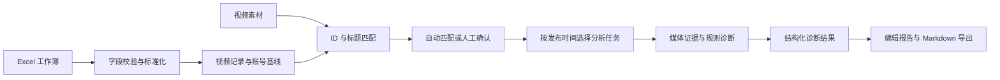

# 微信视频号 AI 创作助手 · 技术方案

[返回项目说明](../README.md)

## 核心模块

| 模块 | 职责 |
| --- | --- |
| Web 应用 | 脚本、审片、热点、导入、匹配与报告的页面和 API |
| 脚本生成 | 根据制作形态、主题、拍摄状态与参考内容生成结构化草稿 |
| 媒体分析 | 提取视频元数据、音频与关键帧，调用语音和视觉 Provider |
| 数据诊断 | 解析工作簿、匹配视频、计算账号基线并生成诊断结果 |
| 热点研究 | 抓取来源、过滤相关内容、聚类并生成选题建议 |
| 数据层 | 保存导入记录、素材关系、任务、脚本草稿与报告 |

## 数据诊断流程

源工作簿与视频保持只读。数据事实、规则结果和 AI 推断分开处理，报告需保留证据来源与能力限制。

## 解析与匹配

- 读取「视频号数据明细」工作表，处理 Excel 日期序列、字符串日期、百分比、数字与空值。
- 同一导入批次校验标准化视频 ID 的唯一性；错误保留行号和字段。
- 标题经过 NFKC 标准化与噪声清洗，结合平台 ID、标题完全匹配、包含关系、Dice 与 Levenshtein 相似度生成候选。
- 匹配分数达到 0.88 可自动确认；0.70～0.88 交由人工确认，接近候选不强行绑定。
- 分析队列按 `published_at DESC, spreadsheet_row ASC` 排序。

## 媒体与 AI 处理

FFmpeg / ffprobe 提取元数据、音频与关键帧，语音和视觉 Provider 提供转写与画面证据。Zod / Pydantic 校验结构化结果，规则引擎独立计算账号基线、分位数与互动率。

脚本生成区分已拍摄和未拍摄内容，分别给出素材整理或拍摄分镜，并附剪辑指导。Provider 不可用时，支持降级的功能返回有明确标记的模板结果。

## 数据存储与约束

- 本地状态保存草稿、任务和报告编辑稿，与源数据分离。
- 数据库包含导入、视频记录、素材、匹配、任务、转写、片段、分析结果与反馈等实体。
- 每个视频资产只有一条当前匹配；任务状态和队列索引支持任务领取与追踪。
- 用户数据保留 `owner_id`，接口校验归属。
- 私有视频使用受限路径存储，访问地址采用短时签名。
- 留存相关数据表仅作结构预留，当前没有逐秒留存采集能力。

## 技术栈

- Web：Next.js、React、TypeScript、Tailwind CSS、Zod、XLSX。
- 数据：Drizzle ORM、PostgreSQL、本地 JSON 状态存储。
- 媒体：FastAPI、Pydantic、FFmpeg / ffprobe。
- AI：DashScope / Qwen、可替换的语音与视觉 Provider。

## 能力边界

诊断不能从缺失的留存数据推导真实流失秒数，也不能在缺少媒体识别结果时补写字幕或转写。镜头切分优化、OCR、人工转写修订和反馈学习尚未构成完整能力。
