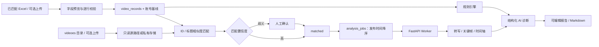

# 微信视频号 AI 创作助手：技术方案

项目：**WeChat Channels AI Assistant**（原「视频号内容诊断助手」）。[返回项目说明](../README.md) · [GitHub 仓库](https://github.com/SherlockMF/wechat-channels-ai-assistant)

本文主要描述数据诊断链路；脚本工作台、发布前审片与热点研究的功能入口和使用条件见项目说明。

## 1. 需求理解

产品核心不是“生成一段 AI 点评”，而是形成可追溯闭环：Excel 数据进入系统后保留原值与标准化值；视频通过可解释的本地算法匹配；不确定项由人确认；队列严格按发布时间选择近期视频；Worker 从真实媒体提取元数据、音频、关键帧和时间轴；规则引擎先计算账号基线，AI 只在事实约束内补充内容诊断；最后输出可编辑、可复制、可导出的执行稿。

LOCAL 模式可通过 `LOCAL_SOURCE_WORKBOOK` 和 `LOCAL_VIDEO_DIRECTORY` 指定已匹配工作簿和视频目录。公开仓库不附带这些数据，未配置时仍可使用脚本工作台。源文件只读，关系以工作簿“视频名称”列为准；分析任务和编辑稿进入独立的 `.data/local-state.json`。REAL 模式仍使用 PostgreSQL 与 Worker。

## 2. 关键技术风险

1. Excel 单元格混合日期、百分比、字符串和空值：逐行解析并返回行号、字段和原因，空值保持 `NULL`。
2. 中文文件名噪声导致误匹配：NFKC 标准化、emoji/话题/版本后缀清洗，加权 Dice 与 Levenshtein；接近候选强制人工确认。
3. 视频编码与系统 FFmpeg 差异：上传阶段只做快速 ffprobe，Worker 失败时保存错误码并允许重试。
4. AI 输出漂移或虚构：规则计算与 AI 分离，Zod/Pydantic 双侧校验，真实 Provider 应执行一次 JSON 修复。
5. 没有逐秒留存却做确定性归因：所有规则与 Prompt 强制写入限制，只能标记“疑似问题区间”。
6. 大文件与私有数据：数量、扩展名、MIME 和大小限制；文件写入私有目录，仅通过短时 HMAC 签名地址读取。

## 3. 数据流



## 4. 项目目录

```text
apps/
  web/                 Next.js 页面、API、导入、匹配、指标与报告
  worker/              FastAPI、任务轮询、FFmpeg、Provider
packages/
  database/            Drizzle Schema 与 SQL 迁移
  shared-types/        Zod Schema 与共享 TypeScript 类型
  prompt-templates/    版本化 Prompt
docs/                  技术方案
docker-compose.yml
.env.example
README.md
```

## 5. 数据库设计

迁移包含 `imports`、`video_records`、`video_assets`、`video_matches`、`analysis_jobs`、`video_transcripts`、`video_segments`、`analysis_results`、`recommendation_feedback`、`retention_datasets`、`retention_points`。关键约束：

- 同一导入批次的标准化平台视频 ID 唯一；
- 每个视频资产只有一条当前匹配；
- 任务状态使用 PostgreSQL enum；
- 队列索引覆盖 `status, created_at`；
- 发布时间索引覆盖 `import_id, published_at, spreadsheet_row`；
- 留存点按 dataset 与 second 唯一；
- 所有用户对象保留 `owner_id`，API 校验归属。

## 6. 分阶段计划

- P0-A：Monorepo、共享 Schema、迁移、Docker Compose。
- P0-B：真实 Excel 导入、预览、回滚、批量视频私有存储与匹配确认。
- P0-C：近期队列、任务状态、FFmpeg 元数据/音频/关键帧、Provider 接口。
- P0-D：账号基线、规则诊断、结构化结果、单视频页面与 Markdown。
- P1：镜头切分优化、OCR、人工修订转写、反馈闭环、同长度对比。
- P2：扩展采集、留存同步与新旧视频验证。

## 7. 依赖

- Web：Next.js、React、TypeScript、Tailwind CSS、TanStack Table、Recharts、React Hook Form、Zod、XLSX、Drizzle ORM、pg。
- Worker：FastAPI、Pydantic、psycopg、httpx、FFmpeg/ffprobe。
- 基础设施：PostgreSQL 16；真实部署可把私有存储适配到 Supabase Storage。
